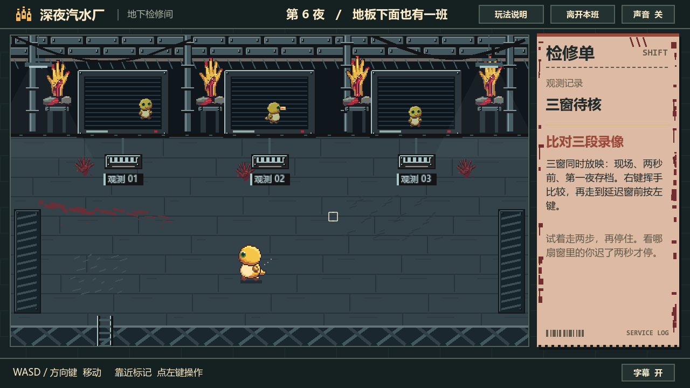

# 夜班只有三只 · Night Shift

单人俯视角像素恐怖游戏。你是夜班送货员奶龙。第一夜只开一扇暖黄色的小窗。熟悉工作以后，厂里出现了三份彼此矛盾的口供、一盘记着你脚步的旧录像，以及必须撑到奶蛙醒来的四面值班室。广播、同伴的对白和影响操作的声音都带中文字幕。

## 开始夜班

在课程机器上双击 [play.cmd](play.cmd)。领取本机工牌，或用已有昵称和口令登录。在名册第一次点「开始」会打开四页图解，依次演示试工送货、辨认真伙伴、漏投与护栏、遇险逃生。点「明白了，开始试工」才会发出第一单。标题页、名册和出货间都有「玩法说明」，当班翻阅时本局暂停，返回后从原处继续。[查看第一夜的图解](docs/night-screens/first-shift-handbook.png)

Windows x64 离线发行包也随本机交付。将压缩包完整解压，双击包里的 `Play.cmd`，启动器会使用随包的 Godot、Java 与 PostgreSQL。普通玩家的发行版进度保存在 `%LOCALAPPDATA%\OnlyThreeOnShift`。[离线版使用说明](tools/distribution/player-zh.txt)

**第一夜怎么过？** 站在地板上的小黄龙就是你。把鼠标放到上方正中央 **2 号窗**的伙伴身上，点一下**左键**。等交班票更新，再送下一瓶，三瓶都送这个窗口。右键弹盖可以留到第二夜再学。送完用方向键或 WASD 走到地板下沿正中央的门，靠近就能打卡。左下和右下的两个小把手是备用泄压拉杆，这一夜都用不到。

**第二夜怎么辨认？** 例如交班票写着上单「← 左」，就把鼠标移到地板上奶龙的**右边**，按一下**右键**，再看两扇窗。谁朝右伸手，就左键把瓶子投给谁。即使它站在左窗，也可以向右伸手。上单记录向右时，左右对调。

| 操作 | 用法 |
|---|---|
| WASD 或方向键 | 移动、避开即将塌落的砖、靠近工位和机关 |
| 鼠标右键 | 按鼠标相对于奶龙的左右方向弹盖。看窗口里的手或左右标志，与交班票上记录的上一单方向比较 |
| 鼠标左键 | 送货时朝指针抛瓶。进入检修层和录制室后，在标记旁操作。在最后一夜靠近亮起的支撑装置，按住左键扶稳 |
| 送给冒牌货或压力耗尽 | 用方向键走到亮起的那根泄压杆旁，会自动拉下，再跑到南门。逃脱或被追上后都能重试本关 |

第四夜可以从安全平台直投，也可以走近路、瞄准侧墙反弹。第五夜要比较两次反向试探，找出两次都跟对的伙伴。第六夜可以故意停步或挥手，比较三台监视器的动作。

**第七夜末闸怎么过？** 在录制台点左键，走到踏板上站满两秒，看见「可封存」再点一次左键。回到录制台意味着录像开始回放。白脸、标着「你」的奶龙由你控制，标着「录像」的分身会替你踩板。第二段回放时，压印滚轮从左侧追过来。沿地面箭头从隔柱上侧绕过，向右穿过第一层门，站上末闸前的白线。**从现在开始一直按住 D 或 →**，门抬起就会直接通过。踏穿裂砖或被滚轮追上会从这段回放重来，错过末闸只退到门前。

[第七夜实机：绕柱时的白箭头与压印滚轮](docs/watch-screens/10-recorded-footsteps.png) · [末闸的位置与「你」「录像」标牌](docs/watch-screens/10-sill-with-labels.png)

**第八夜怎么玩？** 先记住奶蛙在哪扇窗里。闭帘后看头顶的睡眠环，一边跟踪四面窗口交换的轨迹，一边留意机器和脚下的砖。亮起扶稳标记时走近按住左键。圆环走完，再到你记住的窗前右键试探，看到回应后左键送瓶。一共三轮，失手从当前轮重来。[八夜详细规则](docs/night-design.md)



[三分钟图文分镜](docs/夜班只有三只-三分钟分镜.pdf) · [概念插画](docs/night-concepts/) · [守夜版实机截图](docs/watch-screens/) · [可重建的角色与动作图集](art/night_cast/cast.png)

## 文件和技术边界

```text
art/                      像素角色、工厂背景与 Blender 汽水瓶的可编辑源文件
backend/
  src/main/scala/soda/
    Main.scala            组装 Cats Effect 资源、数据库和 http4s 服务
    identity/             登录、玩家标识、口令哈希、会话签发与验证
    infrastructure/       SQL 事务、连接生命周期、HTTP 字段检查
    night/                关卡与输入类型、纯模拟、单人对局和进度
  src/test/scala/         规则与服务边界回归
game/
  project.godot           Godot 4 项目
  main.tscn               夜班游戏入口
  night/                  控制器、网络、界面、世界表现与音响
  assets/night/           游戏用角色、取货窗口、插画和道具
  tests/                  真实操作通关驱动
docs/                     玩法、协议、三分钟演示分镜和截图
tools/                    接口验收、MCP 与发行工具
```

后端使用 Scala 3、Cats Effect、http4s、Circe 与 PostgreSQL。身份、当班对局、进度三个服务在同一个 JVM 部署，各自管理自己的状态。每秒模拟 20 次。图形帧率或点击次数不会让时间流得更快。

地砖和投递平台归 `FactoryFloor` 管理。检修层与录制室使用独立的阶段枚举，终章的三轮守夜由 `SleepWatch` 推进。字幕、音效和动画消费同一个剧情事件与序号。源代码中拼错剧情事件名会在 Scala 编译时被拒绝。[章节状态机](backend/src/main/scala/soda/night/StoryPuzzles.scala) · [守夜状态机](backend/src/main/scala/soda/night/SleepWatch.scala) · [剧情事件类型](backend/src/main/scala/soda/night/StoryVocabulary.scala)

| 服务或组件 | 职责 | 向其他组件提供什么 |
|---|---|---|
| 身份服务 | 昵称与口令登录、验证令牌 | 经过验证的玩家身份，供关卡访问控制使用 |
| 夜班对局服务 | 开局、席位归属、输入序号、模拟时钟 | 只有对局主人能查看、投掷、移动。重发同一个输入序号只确认一次 |
| 纯模拟 | 计算投递、塌砖和拉杆，推进观察窗、录制回放与守夜三个故事章节 | 输入上一帧世界和经过验证的意图，输出可见角色的位置、机关、字幕事件和计时。回放动作与门闩判定均在服务端 |
| 进度服务 | 判断可进入的夜班，收班时记录通关、最佳表现和首夜脚步 | 老工牌继续沿用进度。有首夜记录时，地下观察窗可重放自己的动作。旧档可使用厂里的示范录像 |
| Godot 客户端 | 捕获方向和按键、验证快照、画出眼神、手势、瓶子轨迹与惊吓 | 客户端提交意图，以服务端的送达、逃生和解锁结果更新界面 |

### 一次故意反向的试探

上单向右，这次奶龙向左弹盖。Godot 只提交瞄准向量和 `probe`。Scala 检查令牌、对局归属、范围和输入序号，在之后的 tick 计算各个窗口可见的反应。快照可以出现“左窗看右，右窗看左”，其中没有真窗编号。玩家选择向某扇窗投瓶，服务器才根据真实轨迹和收件人作出判定。

### API

| 方法 | 用途 |
|---|---|
| GET /health | 检查游戏与数据库是否就绪 |
| POST /v1/sessions | 昵称与口令换取玩家令牌 |
| GET /v1/night/profile | 读取解锁上限、已通关关卡及最佳成绩 |
| POST /v1/night/start | 用关卡编号与请求 UUID 开始一班 |
| GET /v1/night/run/{runId} | 读本人对局快照 |
| POST /v1/night/run/{runId}/input | 发送移动、瞄准和单次动作，取得输入确认及快照 |

JSON 在两端的网络边界转换为有业务含义的值，输入和胜负不共用一个数据结构。Scala 的枚举表达上班、柜下入侵、等待打卡、正常下班、逃脱与被捕。数据库、随机种子和时间属于外层效果；相同初始世界与输入序列可以用纯模拟重播。[完整字段、坐标与状态契约](docs/night-wire.md) · [课程类型安全笔记](https://github.com/zhuyf25t/nailong/blob/4807568e2b62775c2c3bb9cedfd493de9070b830/类型安全%2010.29.pdf)

## 从源码运行与复验

开发环境使用 Windows、JDK 21、sbt、PostgreSQL 和 Godot 4.7.2。可将 `GODOT_BIN` 指向 Godot 可执行文件，`SODA_PG_BIN` 指向 PostgreSQL 的 bin 目录。首次从源码运行会解析 Scala 依赖。开发服务默认使用 `127.0.0.1:8738`。旧版仍在运行时，启动器可使用 `8740` 或 `8741`，沿用同一张本机工牌。开发数据库使用 `127.0.0.1:55439`。退出所有窗口后可运行 `.\stop.ps1` 正常关闭后台。数据库和口令保存在忽略版本控制的 `backend/.night-runtime/`。源码版和发行版各有自己的数据库和本机工牌。

| 命令 | 作用 |
|---|---|
| `.\backend\build.ps1` | 编译 Scala 并运行自动测试 |
| `.\play.cmd -SmokeTest` | 从游戏入口启动服务，用 Godot 体验八夜 |
| `py -3 backend/tests/night_http.py --all-nights` | 在运行中的开发服务上检查鉴权、关卡锁、输入去重、故事章节和通关落库。可用 `SODA_API_URL` 指定服务地址 |

本机已有 D 盘的 Blender 与 Godot。Codex 中的 `hw3_blender` 可检查制作源，`hw3_godot` 可导入游戏、运行主场景。[MCP 工具配置](tools/mcp/README.md)

实机回归使用新工牌，通过鼠标和移动操作完成八夜。终夜第二轮故意送错窗后，第一轮的进度仍保留。完成第三轮、走出东南门后重新登录，名册显示八枚夜班章。[Godot 体验回归](game/tests/night_playthrough.gd) · [通关后重新登录的实机名册](docs/watch-screens/16-stamped-roster.png)
