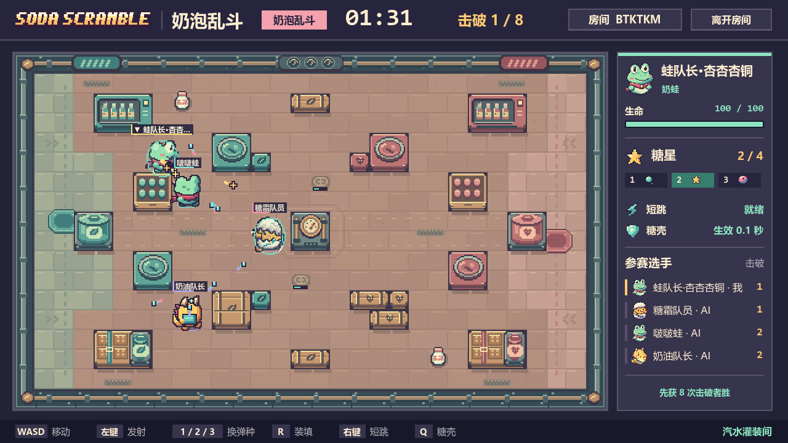

# 奶泡乱斗 · Soda Scramble

奶龙、奶蛋和奶蛙在一间汽水厂里争夺瓶盖旗。玩自由乱斗时，中央交叉口适合抢分；玩夺旗时，同一个路口又成了保护队友回家的要道。游戏使用原生 Godot 2D 像素场景，角色外观可选，三种发射器的手感各不相同。



[三分钟演示分镜 PDF](docs/奶泡乱斗-三分钟分镜.pdf) · [六张概念效果图](docs/concepts/) · [实机夺旗](docs/screenshots/04-flag.png) · [两位玩家同房](docs/screenshots/two-clients.png) · [完整实机图库](docs/screenshots/)

## 开始玩

双击 [play.cmd](play.cmd)。首次输入昵称并设置至少八个字符的口令，即可创建本地账号。之后用相同凭据登录，可以读回个人战绩。在大厅选角色、模式并创建房间，另外三个席位由 AI 填充。想和朋友在这台电脑上试玩，可以再启动一个窗口，用另一账号输入六位房间码。四个席位共用一场实时比赛。

| 操作 | 效果 |
|---|---|
| WASD / 方向键，鼠标，左键 | 移动、瞄准、持续发射 |
| 1 / 2 / 3，R | 切换奶泡、糖星、珍珠，或给当前发射器装填 |
| 右键，Q | 沿移动方向短跳改变位置，或开启短时减伤的糖壳 |
| 经过奶瓶 / 旗台 | 受伤时补充生命。夺旗时触碰敌旗，再送回有本方旗的基地得分 |

每局最多两分钟。自由乱斗先到 8 分者胜，夺旗先送回两面旗的队伍胜，时间耗尽时比较比分，并列判平。每个席位都遵循同一套碰撞、冷却与复活规则。第一次玩可以先绕外圈熟悉控制，再在中央切换糖星观察扇形弹道。[参考资料、玩法取舍与像素风格](DESIGN.md)

两个窗口共用本机后台。关掉其中一个仍可在另一窗口继续游戏，结束演示后在仓库根目录运行 `.\stop.ps1` 可正常停止本项目的 Scala 服务和数据库。课程机器上的 Godot 4.7.2 与 Blender 4.5.16 LTS 位于 `D:\HW3Tools`。启动器自动导入资源。

**两台电脑同局**　主机在仓库根目录打开 PowerShell，将 `$env:SODA_BIND_HOST` 设为自己实际的局域网 IPv4，再运行 `.\backend\start.ps1`。双方电脑从各自的工程目录运行 `.\play.ps1 -ConnectTo http://主机IPv4:8737`，用不同账号输入同一房码。主机需要允许二者通过该端口通信，远端客户端只需 Godot 和游戏文件。手动启动的主机服务在原终端按 Ctrl+C 退出。

## 课程步骤与美术制作

课程第六讲的第 2–5 页演示 Blender 和 Godot 的安装、MCP 连接和场景运行，第 10 页接入 Scala 3、Cats Effect 和 PostgreSQL，第 11 页示范四个席位的对战。本作沿用这条制作流程，把舞台和角色做成 2D 像素。结算时举起的瓶盖奖杯在 Blender 里建模，以正交相机渲染成 64 × 64 透明贴图。[奖杯源文件](art/trophy/soda_cup.blend)

三个角色各有四个方向的站立、移动和动作帧，共 72 帧。角色、头像、机器、糖箱和 UI 使用同一套轮廓与色板。场地绘图直接读取与碰撞相同的地图数据，改动通道后可以重新生成底图。[角色与头像](art/characters/cast-preview.png) · [场地绘制代码](art/arena/paint.py) · [UI 图集源文件](art/ui/build_atlas.py)

本机 Codex 已接入 `hw3_blender` 和 `hw3_godot`。前者能检查和制作模型，后者能重新导入本工程并运行指定场景。实际工具调用读回了奖杯的 7 种材质，也成功运行了 Godot 主场景 60 帧。[工具清单和复现方法](tools/mcp/README.md)

## 项目结构

```text
hw3/
  DESIGN.md                     原作规则与攻略、本作边界、视觉与分镜
  docs/                         接口协议、三分钟图文分镜、概念图与实机图
  art/                          可重建的角色、场地图块和奖杯美术源
  game/
    project.godot               Godot 4 桌面入口
    data/arena.json             服务器与客户端共用的碰撞格、出生点、旗台和补给点
    assets/                     像素角色帧、头像、场景底图、补给、奖杯与插画
    network/                    会话、请求队列、严格的 JSON → 游戏对象转换
    ui/                         登录、选人、房间、场外仪表、结算与战绩
    world/                      原生像素竞技场、角色朝向、投射物、事件反馈
    tests/                      素材与实机流程验证
  backend/
    src/main/scala/             Scala 3 入口、会话、房间时钟、模拟与持久化
    src/test/scala/             领域规则与类型检查的回归用例
  tools/                        两个 MCP 制作工具及跨客户端验收
  play.cmd / play.ps1           启动一个游戏窗口，复用同一个本机房间服务
  stop.ps1                      停止本项目的后台服务
```

## 服务架构

Scala 3 / Cats Effect 管理会话、房间时钟、资源生命周期和数据库 I/O。服务有各自的类型接口，共用一个 JVM 和一个 HTTP 入口。20 Hz 的战斗循环在内存中运行，PostgreSQL 保存账号、认证和已经结算的成绩。在本机上启动一套服务即可同时连接多个 Godot 窗口。

| 服务 | 拥有的状态 | 交互与一致性 |
|---|---|---|
| 身份与会话 | 玩家身份、口令验证、令牌 | 认证路由将 Bearer 凭据解析为玩家身份，业务请求只能代替自己占用的席位提交输入 |
| 房间与席位 | 六位房码、四个席位、真人/AI 控制归属、最后确认的输入序号 | 创建时分配一席，其余由 AI 补齐。主动离场立即释放。若客户端失联，约 0.3 秒后清除持续动作，8 秒后 AI 接手 |
| 对战模拟 | 位置、生命、弹匣、技能、投射物、旗、比分和终局 | 周期时钟调用纯规则函数。一次 tick 读取意图、推进世界并输出快照，全场四席观察同一结果 |
| 成绩与历史 | 已结束对局及参与者的结算记录 | 由服务器从终局提取个人结果写入 PostgreSQL，按玩家读取最近战绩，同一局的终局重试只登记一次 |
| Godot 展示与输入 | 账号界面、鼠标与键盘意图、已解码快照、短时表现事件 | 客户端能平滑绘制服务器位置、播放声音和像素特效；得分、命中、补给和夺旗必须经过 Scala 判定 |

房间与逐帧状态驻留内存。比赛仍在进行时，掉线玩家可以凭房码重新加入可用席位。重启服务会结束进行中的比赛，数据库保留账号和已结算战绩。

### 一面旗怎样记分

1. Godot 发送移动方向、瞄准方向和当前动作，携带玩家令牌、房码和输入序号。
2. 房间服务校验玩家是否有权控制该席，把新输入交给模拟。网络重传旧序号时，已经处理的动作不会再触发。
3. Scala 在下一次 tick 判断角色是否存活、是否接触旗台、携带的是哪方的旗，以及自己基地的旗是否在家。
4. 条件满足时，替换世界中的旗、比分及胜负状态。Godot 根据快照更新两方比分，并对同一个事件 ID 只播一次音效。
5. 达到 2 分或时限时，服务器结束比赛并保存结果。重新登录查询的是该玩家在数据库中的成绩。

### 类型安全怎样落地

项目沿用 nailong 笔记的做法，在网络边界检查字段、枚举与有界值。房间标识、席位、序号、模拟 tick 和像素位置各有自己的语义。输入意图只描述玩家能按下的操作。模拟显式表达存活、复活倒计时、携旗者与终局分支。时间、数据库和网络放在有副作用的外层，纯规则可以在特定 tick 复现。Godot 同样检查返回字段、有限数值、席位索引和有限状态后再绘制。[仓库历史中的类型安全笔记](https://github.com/zhuyf25t/nailong/blob/4807568e2b62775c2c3bb9cedfd493de9070b830/类型安全%2010.29.pdf)

例如生命值和模拟时钟都可编码为整数。Scala 将二者分别定义为 `Health` 和 `SimTick`，把 `Health.full` 传到要求 `SimTick` 的位置会被编译器拒绝。身份与积分也分清了归属：席位面板显示这个席整局的击破数，个人战绩的 `score` 只累加玩家本人控制该席期间的击破。提前离开且结算时已交回 AI 的玩家记负。

地图用不可变的距离表供 AI 寻路；对战时，`Engine.step` 根据当前世界与输入返回下一份世界。账号登录和成绩写入位于数据库事务边界，房间抢位用 `Ref.modify` 原子完成。编译器开启 `-Werror`。[领域类型](backend/src/main/scala/soda/sim/Model.scala) · [规则与编译回归](backend/src/test/scala/soda/sim/EngineSuite.scala) · [Godot 解码边界](game/network/soda_state.gd)

## HTTP 与运行环境

HTTP 服务默认监听 `127.0.0.1:8737`，项目数据库使用本机 55437 端口。在新的 Windows 电脑上，安装 JDK 21、sbt、PostgreSQL 和 Godot 4.7.2。将 `JAVA_HOME` 指向 JDK，将 `sbt.bat` 加入 PATH，并将 `GODOT_BIN` 指向 Godot 的 exe。若脚本未找到数据库工具，将 `SODA_PG_BIN` 指向含 `pg_ctl.exe` 的目录。第一次运行需要下载 Scala 依赖。数据库运行目录和本机口令留在忽略版本控制的 `.runtime` 中。

| 接口 | 请求的作用 |
|---|---|
| GET /health | 确认数据库与奶泡乱斗服务就绪 |
| POST /v1/sessions | 登录并取得 Bearer token |
| POST /v1/rooms，POST /v1/rooms/{code}/join | 建房或加入，返回自己的席号、四席名单和世界快照 |
| POST /v1/rooms/{code}/input | 声明移动、瞄准、开火、换槽、跃步或护盾，返回确认序号和快照 |
| GET /v1/rooms/{code}，POST /v1/rooms/{code}/leave | 拉取当前比赛，或把席位交回 AI |
| GET /v1/history | 读取本人最近的已结算比赛 |

精确请求和响应示例、错误语义见[会话与房间契约](docs/api.md)。各武器数值、tick、旗帜、事件和胜负的数据结构见[模拟协议](docs/simulation-wire.md)。

## 如何复验

在仓库根目录执行。联机脚本使用正在运行的本机游戏服务。

| 命令 | 检查内容 |
|---|---|
| `.\backend\build.ps1` | Scala 的 13 项测试，覆盖类型误用的编译器拒绝、边界解析、确定性模拟，以及 AI 完成两种赛制 |
| `.\play.cmd -SmokeTest` | 与双击共用启动器，导入资源，用 Godot 走登录、选角、作战、结算和战绩全流程 |
| `py -3 tools/check_multiplayer.py` | 四个独立账号加入、房满拒绝、重复请求、合法送回两旗和四方终局一致 |
| `py -3 tools/duo/check.py --capture` | 两个独立 Godot 图形客户端，互看移动、糖壳以及玩家离开后的 AI 接手 |

