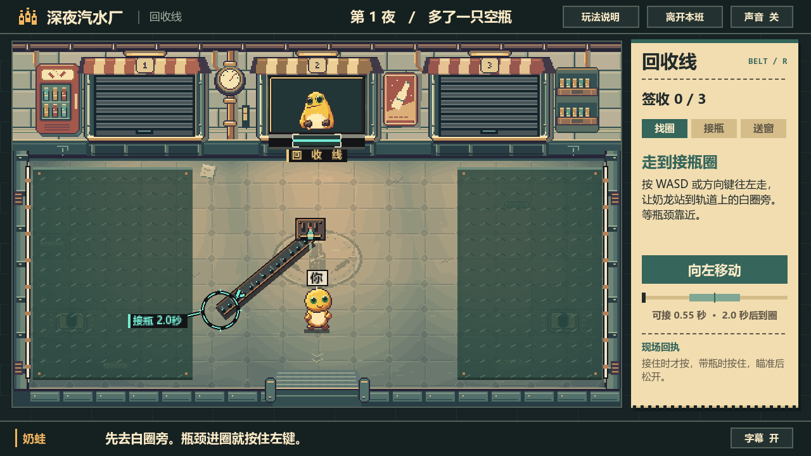
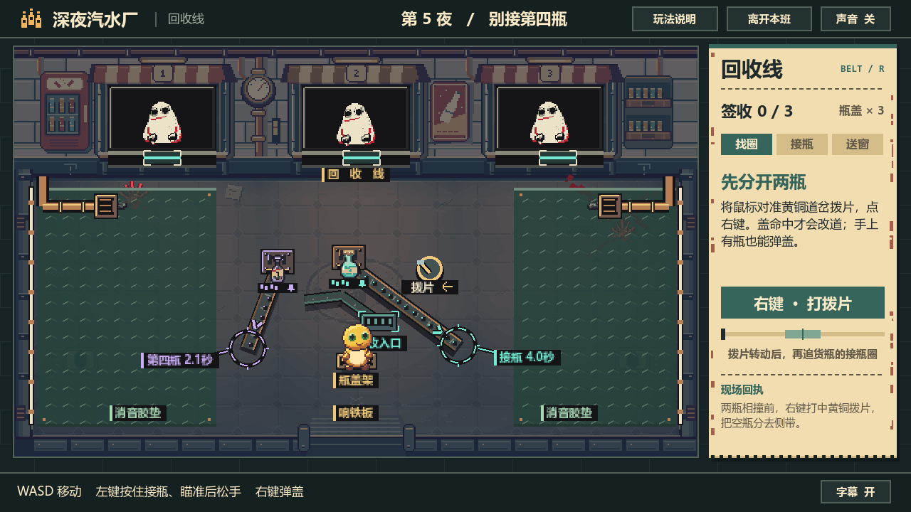

# 夜班只有三只 · Night Shift

单人俯视角像素动作恐怖游戏。你是夜班送货员奶龙。第一夜的工作很简单：在回收线上接住汽水，再送进暖灯下的窗口。第三瓶签收后，却有第四只空瓶从厂里滚出来，里面装着你刚才在车间弄出来的声音。此后的七个夜班，脚步和瓶声也成了你的工具。关键声音有同步的中文字幕和场内提示。

## 开始夜班

在课程机器上双击 [play.cmd](play.cmd)。领取本机工牌，或用已有昵称和口令登录。从名册开班后，新版手册会演示接瓶、松手投递、拨岔和抢救。标题页、名册和出货间都可以重看「玩法说明」。在班中翻阅时，来瓶、追击和睡眠环都会暂停。

Windows x64 离线发行包也随本机交付。将压缩包完整解压，双击包里的 `Play.cmd`，启动器会使用随包的 Godot、Java 与 PostgreSQL。普通玩家的发行版进度保存在 `%LOCALAPPDATA%\OnlyThreeOnShift`。[离线版使用说明](tools/distribution/player-zh.txt)

**第一夜怎么接？** 先用方向键或 WASD 把小黄龙移到地上的接瓶圈。盯着从输送线上滚来的瓶颈，等它进入可接范围，**按下左键，暂时别松**。拿稳后把准星移到上方正中收货窗，再**松开左键**。漏接时立即看下层带的接瓶点。第三趟会弹回来一次，横移去接，再送进窗。三单签收后去地板下沿正中的南门。



**第二夜怎么认窗？** 用右键把盖子瞄向收货窗。真伙伴能实实在在地接住盖子。假伙伴也会伸手，盖子却会穿过掌心。记住你看见的结果，把汽水送进真正接住盖子的那扇窗。

| 操作 | 用法 |
|---|---|
| WASD 或方向键 | 移动、避开即将塌落的砖、靠近工位和机关 |
| 鼠标右键 | 朝准星弹盖，可试窗、击中管口诱敌或打道岔；侧墙能反弹一次 |
| 鼠标左键 | 回收线按下接瓶、按住带瓶移动、松手投向准星。检修和录制机关仍可走近点击；终夜靠近亮杆按住扶稳 |
| 漏接或投偏 | 先看下层带的落点，有一次追过去抢救的机会。碎瓶从当前这趟重来 |

第四夜可以直接投窗，也可以先把瓶送进回收带，边跑边弹盖改道，再截回来。一次实测中，奶龙向左截瓶时朝右墙弹盖，盖子反弹敲管；接住后折向右，在移动的窗缝收窄前松手。第五夜有两瓶同时在场。瓶身里的三声记录会在另一段带上依次响起，带动怪物调查声源。第六夜先对比三台监视器，再借延迟录像压板，与声音瓶配合过门。[第四夜直投实机](docs/relay-screens/06-direct.png)

**第七夜末闸怎么过？** 在录制台点左键，走到踏板上站满两秒，看见「可封存」再点一次左键。白脸、标着「你」的是玩家，标着「录像」的分身会替你踩板。第二段回放时先弹盖拨岔，接瓶，把汽水送进末端接货槽；沿上侧绕开隔柱，跟在瓶子后面穿过第一层门。到了末闸前白线，**一直按住 D 或 →**，门抬起就能通过。错过末闸只退到白线。

[第七夜实机，压辊追来时对准末端货槽](docs/relay-screens/10-signature-relay.png) · [末闸白线与「按住 D」指引](docs/relay-screens/10c-sill-wait.png)

**第八夜怎么玩？** 先记住奶蛙在哪扇窗。闭帘后盯住窗口换位，留意睡眠环和地面的手。亮杆时走近按住左键。第二、三轮第一次稳住杆，回收带就会启动。第二轮要在环归零前拨好道岔；第三轮用带声瓶把假窗引走，还得在归零前接回瓶。醒后靠近你记住的那扇窗，右键试探，看到回应后左键送给奶蛙。失手只重来当前轮。[八夜玩法与操作](docs/night-design.md)

[终夜实机，睡眠环还剩 18.2 秒时，右边的瓶子开始播放脚步声](docs/relay-screens/12-frog-lure.png)



[三分钟图文分镜](docs/夜班只有三只-三分钟分镜.pdf) · [回收线实机截图](docs/relay-screens/) · [概念插画](docs/night-concepts/) · [可重建的角色与动作图集](art/night_cast/cast.png)

## 文件和技术边界

```text
art/                      像素角色、工厂背景与 Blender 汽水瓶的可编辑源文件
backend/
  src/main/scala/soda/
    Main.scala            组装 Cats Effect 资源、数据库和 http4s 服务
    identity/             登录、玩家标识、口令哈希、会话签发与验证
    infrastructure/       SQL 事务、连接生命周期、HTTP 字段检查
    night/                关卡与输入类型、纯模拟、单人对局和进度
  src/test/scala/         规则与服务边界回归
game/
  project.godot           Godot 4 项目
  main.tscn               夜班游戏入口
  night/                  控制器、网络、界面、世界表现与音响
  assets/night/           游戏用角色、取货窗口、插画和道具
  tests/                  真实操作通关驱动
docs/                     玩法、协议、三分钟演示分镜和截图
tools/                    接口验收、MCP 与发行工具
```

后端使用 Scala 3、Cats Effect、http4s、Circe 与 PostgreSQL。身份、当班对局、进度三个服务在同一个 JVM 部署，各自管理自己的状态。每秒模拟 20 次。图形帧率或点击次数不会让时间流得更快。

回收线的瓶子、飞盖、闸口、追击者与声音记录都由 Scala 模拟。章节状态机把同一条回收线接进检修层、录制室和守夜。客户端依据公开轨迹绘制，按事件序号消费字幕、音效与动画。[回收线公开投影](backend/src/main/scala/soda/night/RelayView.scala) · [章节状态机](backend/src/main/scala/soda/night/StoryPuzzles.scala) · [守夜状态机](backend/src/main/scala/soda/night/SleepWatch.scala)

| 服务或组件 | 职责 | 向其他组件提供什么 |
|---|---|---|
| 身份服务 | 昵称与口令登录、验证令牌 | 经过验证的玩家身份，供关卡访问控制使用 |
| 夜班对局服务 | 开局、席位归属、输入序号、模拟时钟 | 只有对局主人能查看、投掷、移动。重发同一个输入序号只确认一次 |
| 纯模拟 | 计算瓶颈与手的距离、盖子反弹、道岔、带声瓶回放以及怪物捕捉声源的时机；控制观察窗、录像门和守夜 | 根据上一帧和玩家意图，输出可见轨迹、机关、字幕事件和计时。回放与门闩判定均在服务端 |
| 进度服务 | 判断可进入的夜班，收班时记录通关、最佳表现、首夜行走轨迹和三声回响 | 老工牌沿用进度。地下观察窗可重放自己的动作；缺少个人录像时可看厂里的示范录像 |
| Godot 客户端 | 捕获方向和按键、验证快照、画出眼神、手势、瓶子轨迹与惊吓 | 客户端提交意图，以服务端的送达、逃生和解锁结果更新界面 |

### 一次跑动中的接投

玩家向左截瓶、同时向右弹盖。每次输入独立保存当时的移动、准星和序号。Scala 按序处理 `probe`、`catch` 和 `release`，在模拟时钟上判断站位、抓取时间和瓶子飞行的真实交点。网络重试同一输入序号只消费一次。窗口的接盖、穿掌和收货都是观察到接触后才产生的结果。

### API

| 方法 | 用途 |
|---|---|
| GET /health | 检查游戏与数据库是否就绪 |
| POST /v1/sessions | 昵称与口令换取玩家令牌 |
| GET /v1/night/profile | 读取解锁上限、已通关关卡及最佳成绩 |
| POST /v1/night/start | 用关卡编号与请求 UUID 开始一班 |
| GET /v1/night/run/{runId} | 读本人对局快照 |
| POST /v1/night/run/{runId}/input | 发送移动、瞄准和单次动作，取得输入确认及快照 |

JSON 在两端的网络边界转换为有业务含义的值，输入和胜负不共用一个数据结构。Scala 的枚举表达上班、柜下入侵、等待打卡、正常下班、逃脱与被捕。数据库、随机种子和时间属于外层效果；相同初始世界与输入序列可以用纯模拟重播。[完整字段、坐标与状态契约](docs/night-wire.md) · [课程类型安全笔记](https://github.com/zhuyf25t/nailong/blob/4807568e2b62775c2c3bb9cedfd493de9070b830/类型安全%2010.29.pdf)

## 从源码运行与复验

开发环境使用 Windows、JDK 21、sbt、PostgreSQL 和 Godot 4.7.2。可将 `GODOT_BIN` 指向 Godot 可执行文件，`SODA_PG_BIN` 指向 PostgreSQL 的 bin 目录。首次从源码运行会解析 Scala 依赖。开发服务默认使用 `127.0.0.1:8738`。旧版仍在运行时，启动器依次检查 `8740`、`8741` 和 `8742`，沿用同一张本机工牌。开发数据库使用 `127.0.0.1:55439`。退出所有窗口后可运行 `.\stop.ps1` 正常关闭后台。数据库和口令保存在忽略版本控制的 `backend/.night-runtime/`。源码版和发行版各有自己的数据库和本机工牌。

| 命令 | 作用 |
|---|---|
| `.\backend\build.ps1` | 编译 Scala 并运行自动测试 |
| `.\play.cmd -SmokeTest` | 从游戏入口启动服务，用 Godot 体验八夜 |
| `py -3 backend/tests/night_http.py --all-nights` | 在运行中的开发服务上检查鉴权、关卡锁、输入去重、故事章节和通关落库。可用 `SODA_API_URL` 指定服务地址 |

本机已有 D 盘的 Blender 与 Godot。Codex 中的 `hw3_blender` 可检查制作源，`hw3_godot` 可导入游戏、运行主场景。[MCP 工具配置](tools/mcp/README.md)

实机回归使用新工牌，通过鼠标和移动操作完成八夜。测试在第四夜分别走过直接投递、侧线接回与下层抢救。终夜第二轮故意送错窗只重来当前轮。另一次接口验收故意扶稳两根杆、遗漏拨岔，醒铃在截止当拍退回第二轮。完成第三轮、走出东南门后重新登录，名册保留八枚夜班章。[Godot 体验回归](game/tests/night_playthrough.gd) · [接口回归](backend/tests/night_http.py) · [通关后重新登录的实机名册](docs/relay-screens/16-stamped-roster.png)
