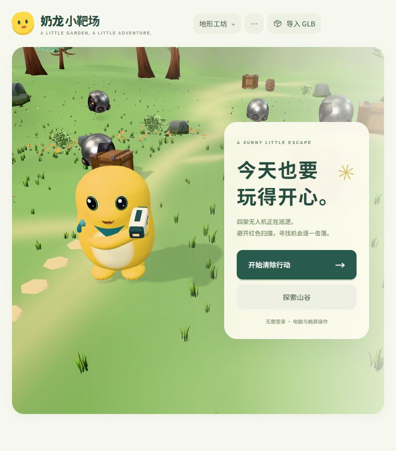
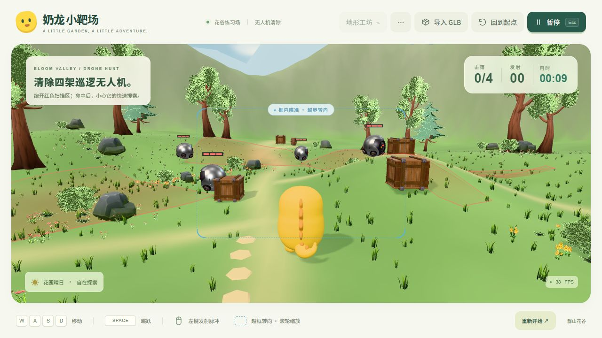
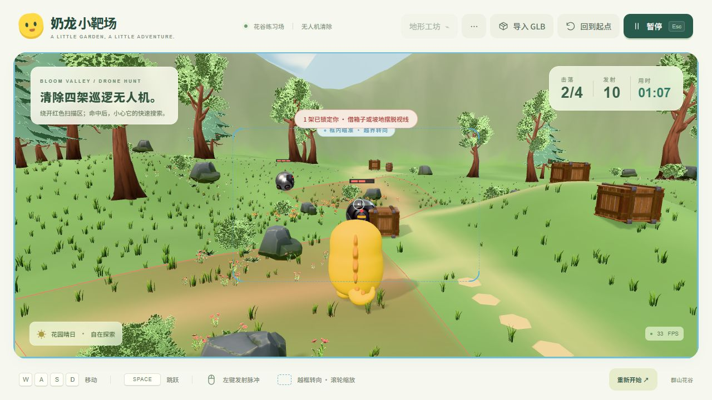

# 奶龙小靶场 · Three.js 前端验证

技术栈为 **TypeScript + Vite + Three.js**。这里是端口 **5174** 的独立渲染与素材验证入口，保留地形工坊、GLB 导入和调试工具；本入口不接账号或数据库。正式 React 应用位于 `../frontend/`，端口 **5173**，已经连接 Scala 与 PostgreSQL，见[项目 README](../README.md)。两者共享 `frontend/src/pages/Training/game/core/` 的游戏核心，本目录 `src/game/*.ts` 只是重导出；移动、扫描、追击、碰撞、弹道和渲染都在浏览器运行，没有 WebSocket。

## 文件结构

```text
threejs/
├── docs/
│   ├── preview-before-style.png  # 浏览器或素材实际截图：before-style
│   ├── preview-character-refresh.png  # 浏览器或素材实际截图：character-refresh
│   ├── preview-controls.png  # 浏览器或素材实际截图：controls
│   ├── preview-countdown-fixed.png  # 浏览器或素材实际截图：countdown-fixed
│   ├── preview-crate-jump.png  # 浏览器或素材实际截图：crate-jump
│   ├── preview-drone-defeat.png  # 浏览器或素材实际截图：drone-defeat
│   ├── preview-drone-hunt.png  # 浏览器或素材实际截图：drone-hunt
│   ├── preview-drone-victory.png  # 浏览器或素材实际截图：drone-victory
│   ├── preview-fantasy-crate.png  # 浏览器或素材实际截图：fantasy-crate
│   ├── preview-game.png  # 浏览器或素材实际截图：game
│   ├── preview-lod.png  # 浏览器或素材实际截图：lod
│   ├── preview-megakit.png  # 浏览器或素材实际截图：megakit
│   ├── preview-mobile.png  # 浏览器或素材实际截图：mobile
│   ├── preview-open-valley.png  # 浏览器或素材实际截图：open-valley
│   ├── preview-render-refresh.png  # 浏览器或素材实际截图：render-refresh
│   ├── preview-tree-occlusion.png  # 浏览器或素材实际截图：tree-occlusion
│   ├── preview-valley-camp.png  # 浏览器或素材实际截图：valley-camp
│   ├── preview-valley.png  # 浏览器或素材实际截图：valley
│   ├── preview.png  # 浏览器或素材实际截图：preview
│   └── PROP_DESIGN.md  # 道具与场景变化的候选设计
├── public/
│   └── assets/
│       ├── arena/
│       │   ├── eye-drone.glb  # 运行用无人机模型与动作
│       │   ├── License_Fantasy_Standard.txt  # 箱桶素材原始许可
│       │   ├── License_SciFi_Standard.txt  # 无人机素材原始许可
│       │   ├── manifest.json  # 所属素材集合的来源、节点与尺寸清单
│       │   └── props.glb  # 运行用 Fantasy 箱桶素材集合
│       ├── models/
│       │   ├── asset-info.json  # 本地生成 GLB 的尺寸、节点和动画清单
│       │   ├── bubble-gun.glb  # 紧凑脉冲枪，沿用旧文件名，含 muzzle
│       │   ├── bush.glb  # 历史程序灌木原型
│       │   ├── crate.glb  # 历史程序木箱原型
│       │   ├── nailong.glb  # 本地梨形角色，含四段动画和挂枪节点
│       │   ├── rock.glb  # 历史程序岩石原型
│       │   ├── target.glb  # 历史圆靶原型，保留素材实验使用
│       │   ├── tree.glb  # 历史程序树原型
│       │   └── wall-segment.glb  # 历史程序矮墙段原型
│       └── nature/
│           ├── License_Standard.txt  # 自然素材 Standard 原始许可
│           ├── manifest.json  # 所属素材集合的来源、节点与尺寸清单
│           ├── megakit-lod.json  # 植被离线 LOD 网格数据
│           └── megakit.glb  # 精选自然植被和岩石模型集合
├── scripts/
│   ├── create-pulse-blaster.mjs  # 生成奶白与深青紧凑脉冲枪模型
│   ├── download-asset-packs.mjs  # 下载选用素材包并校验归档
│   ├── generate-assets.mjs  # 生成并验证本地角色和原型 GLB
│   ├── inspect-asset-packs.mjs  # 检查素材包模型、动画与贴图
│   ├── prepare-arena-assets.mjs  # 整理箱桶和无人机为运行用 GLB
│   ├── prepare-megakit.mjs  # 从 MegaKit 整理精选自然模型
│   └── prepare-nature-lod.mjs  # 离线生成植被简化网格级别
├── src/
│   ├── game/
│   │   ├── assets.ts  # 重导出正式核心：加载 GLB、检查动画节点并建立资源类型
│   │   ├── cameraObstruction.ts  # 重导出正式核心：相机与地形、箱体的遮挡检测
│   │   ├── challenge.ts  # 重导出正式核心：倒数、有效时间、胜负与终局去重
│   │   ├── controller.ts  # 重导出正式核心：键鼠输入、平滑瞄准、蓝框转向与镜头缩放
│   │   ├── defaultRules.ts  # 重导出正式核心：原型默认玩法参数，与正式契约保持对应
│   │   ├── droneBrain.ts  # 重导出正式核心：扫描、受击搜索、锁定、血量与击毁逻辑
│   │   ├── droneEncounter.ts  # 重导出正式核心：组合四机 AI、视线、移动、命中与接触
│   │   ├── droneMotion.ts  # 重导出正式核心：巡逻、追击、避障及连续接触计算
│   │   ├── droneVisuals.ts  # 重导出正式核心：红色扫描区、三格血条与警戒外观
│   │   ├── explosion.ts  # 重导出正式核心：无人机接触爆炸的火光、冲击环与粒子
│   │   ├── gardenDetails.ts  # 重导出正式核心：花谷近景路径和装饰细节
│   │   ├── meadowBackdrop.ts  # 重导出正式核心：天空、远山与场景大背景
│   │   ├── movement.ts  # 重导出正式核心：角色地形运动、跳跃与箱体落脚碰撞
│   │   ├── natureEnvironment.ts  # 重导出正式核心：植被实例、距离分级、淡出与遮挡处理
│   │   ├── natureLod.ts  # 重导出正式核心：读取和选择离线简化植被网格
│   │   ├── obstacles.ts  # 重导出正式核心：统一箱桶等可阻挡几何定义
│   │   ├── props.ts  # 重导出正式核心：可选道具原型及状态更新
│   │   ├── scene.ts  # 重导出正式核心：组装场景、角色、灯光、模型与对象引用
│   │   ├── shooting.ts  # 重导出正式核心：脉冲弹池、枪口闪光与命中反馈
│   │   ├── shootingMath.ts  # 重导出正式核心：连续弹道、准星与首个碰撞点计算
│   │   ├── terrain.ts  # 重导出正式核心：共享高度函数、地形网格与山地边界
│   │   ├── terrainEditor.ts  # 重导出正式核心：原型地形参数编辑与重置
│   │   ├── touchControls.ts  # 重导出正式核心：手机移动、瞄准、射击与跳跃输入
│   │   └── worldLayout.ts  # 重导出正式核心：场景尺寸、出生点及静态物件布局
│   ├── main.ts  # 独立原型的启动、界面、输入与游戏循环
│   └── style.css  # 独立原型的菜单、画布与 HUD 样式
├── tests/
│   ├── camera.test.ts  # 相机避障、跟随与瞄准测试
│   ├── challenge.test.ts  # 倒数、四机全清、失败终局和重开测试
│   ├── config-rules.test.ts  # 共享核心默认参数与正式配置规则一致性测试
│   ├── droneBrain.test.ts  # 扫描角度、受击搜索与视线测试
│   ├── droneMotion.test.ts  # 巡逻、追击、避障与连续接触测试
│   ├── droneTakeoff.test.ts  # 多帧率起飞、保护期、可见受击追击与遮挡搜索测试
│   ├── explosion.test.ts  # 爆炸时间、状态与清理测试
│   ├── movement.test.ts  # 移动、跳跃、坡地和箱体落地测试
│   ├── shooting.test.ts  # 连续弹道、遮挡与命中测试
│   └── terrain.test.ts  # 高度、环山边界与网格预算测试
├── .gitignore  # 排除依赖、产物、工具缓存和本机凭据
├── ASSET_CREDITS.md  # 实际素材来源、作者、许可与修改记录
├── index.html  # 浏览器入口和应用挂载点
├── package-lock.json  # 锁定 npm 依赖版本
├── package.json  # 依赖以及开发、测试和构建命令
├── README.md  # 本目录架构、运行方式与实现说明
├── tsconfig.json  # TypeScript 严格检查配置
└── vite.config.ts  # Vite 开发、构建与路径配置
```

`node_modules/`、`.npm-cache/`、`dist/` 是依赖、缓存和构建输出。已忽略的 `.asset-cache/` 保存原 ZIP、解压目录、资产检查结果和奶龙候选调查；网页只加载 `public/assets/` 的精选资源。

## 当前进展 · 2026-11-01

- **两个新包已下载**：Sci-Fi Essentials Kit Standard 实际含 37 个 glTF 模型；Fantasy Props MegaKit Standard 实际含 94 个。均为作者免费 CC0 版本，没有购买 Pro/Source。
- **四架无人机清除玩法 v2**：使用原包 EyeDrone、Crate_Wooden、Barrel；每架 3 HP，先起飞，再以 1.1 m/s 巡逻和慢扫，发现玩家后以 7.2 m/s 俯冲追击。锁定且仍可见时受击继续追击，未发现或被遮挡时受击才快扫。接触玩家会自爆并结束为失败，四架全部击毁则胜利；不再以 30 秒结束。
- **修复开场缺草缺树**：旧倒计时暂停了环境更新，镜头切到角色背后后仍沿用首页视锥筛选出的实例。现在镜头切换、尺寸变化先刷新可见实例，倒计时继续更新环境；进入首页前也先建立正确的实例并预热扫描材质。
- **可探索山谷已连通**：地形覆盖 160 × 160 m，山脚距中心约 41–53 m，三条小径连接训练点。原小围墙和 ±11 m 活动限制已经移除。可活动区域为山谷与缓坡；近山陡坡是真实碰撞边界，±78 m 的数值保护位于山脊后方。
- **远景进一步减量**：近山并入脚下同一地形，两层纯远景合计从 24,576 减为 3,200 三角面（约减少 87%）；中心地形保留 0.5 m 采样，外围使用 2 m 网格，整块地形仍为 32,768 三角面。远山不是图片。
- **修复过于明显的植被消失圈**：全谷 7,948 个放置实例仍按视野和距离选择 LOD。树、岩石与灌木的低细节轮廓保留到 120 m；草的结束距离按实例错开，桌面约 34–46 m、触屏约 25–33 m，并在前半段开始逐渐降低高度，不再用距离噪点淡出。叶片开启 alpha-to-coverage，降低自发光和向上法线混合，减轻荧光纸片感。
- **本地奶龙重新建模**：连续梨形蒙皮替代上下两个胶囊，背面改为连续柔软短鳍；缩短手脚、收窄眼白、绿色虹膜、小笑嘴，围巾改为深青小前巾。保留四段动画和挂枪节点。仍是本地试验模型，不是网上下载的官方角色；最终是否可爱由实际观感验收。
- **枪和弹丸重做**：奶油白/深青短机身、琥珀能量窗；取消水箱与多节枪管。弹丸为小亮芯、短尾迹，速度 30 m/s、射程 40 m、射速仍为 4 发/s；枪口闪光 55 ms、命中反馈约 220 ms，采用固定对象池。
- **视图稍微放大**：默认距离 8.4 m、FOV 50°，滚轮可在 7–12 m 调整；触屏可用“更多工具”的拉近/拉远按钮。进入游戏仍看角色背面，首页展示正面。
- 保留 WASD、空格跳跃、鼠标平滑瞄准、蓝框越界转镜头、手机触屏、地形工坊，以及“3 秒准备 → 清除四架 → 结算 → 再玩”。道具原型默认隐藏。

当前是**有限、连续的探索地图**，还没有无限区块加载、任务系统或开放世界内容生产工具。先把这一块完整地形的画面、碰撞与性能验证好。

## 运行

```powershell
cd "F:\AstraBel\curriculum\无代码\nailong\threejs"
npm run dev
```

打开 [本地预览](http://127.0.0.1:5174/)。需保持终端运行；Ctrl+C 停止。不要双击 index.html。另一台机器首次运行先安装 Node.js 24，并分别在 `../frontend/` 和本目录执行 `npm ci`：共享核心由正式前端维护，解析依赖时也需要它的依赖目录。原型游玩不需要启动 Scala 或 PostgreSQL；正式账号与成绩应用的启动方式见[项目说明](../README.md#本地启动)。

```powershell
npm run assets       # 重新生成历史原型，普通游玩不需要执行
npm run assets:nature -- "解压后的 Standard 目录" # 重建选用的自然模型包
npm run assets:lod   # 自然 GLB 变化后，离线重建减面索引
npm run assets:arena # 从 .asset-cache 两个已解压原包重新打包箱桶及无人机
npm test             # 运动、碰撞、起飞、追击、弹道、地形与配置一致性测试
npm run typecheck    # TypeScript 严格检查
npm run build        # 构建 dist/
npm run preview      # 生产预览 http://127.0.0.1:4174/
```

网页运行时不请求外部字体、图片、模型或业务 API。

## 实际画面







[开场倒计时修复](docs/preview-countdown-fixed.png) · [实际全清结算](docs/preview-drone-victory.png)

[上一轮跳箱](docs/preview-crate-jump.png) · [树木遮挡处理](docs/preview-tree-occlusion.png) · [上一轮环境](docs/preview-lod.png) · [之前手机竖屏布局](docs/preview-mobile.png)。这些历史截图保留作对照，不代表本轮手机性能验收。

另有历史的 [山脚返回训练点](docs/preview-valley-camp.png) 和 [Fantasy 木箱落脚验收](docs/preview-fantasy-crate.png)。以上素材与渲染截图来自此前版本，不作为 v2 追击或正式账号闭环的验收证据；当前实际检查见[成品验收记录](../docs/VERIFICATION.md)。

## 电脑与手机操作

| 操作 | 效果 |
| --- | --- |
| 首页“探索山谷” | 直接探索；四机同样起飞、扫描和追击，碰撞失败或全清都会结算 |
| 首页“开始清除行动” / 页脚“重新开始” | 重置角色、四架无人机与计数；准备 3 秒后开始，不限时 |
| WASD / 方向键 | 相对镜头移动，斜向不加速；横移和后退保持瞄准朝向 |
| 空格 | 落地或在箱顶时跳跃，空中不能二段跳 |
| 鼠标在蓝框内 | 无需点击即可平滑转身瞄准，镜头稳定 |
| 鼠标越过蓝框四边 | 渐进转镜头，回框停止 |
| 左键 / 长按 | 发射脉冲弹，最多每秒 4 发 |
| 滚轮 / 更多工具中的拉近、拉远 | 平滑缩放镜头，距离限制为 7–12 m |
| 手机左摇杆 | 移动，可同时操作右侧按钮 |
| 手机右侧拖动 | 转镜头，中央准星瞄准 |
| 手机发射 / 跳跃 | 按住发射，单次起跳 |
| Esc / 暂停 / 切走窗口 | 冻结游戏和计时，返回后手动继续 |
| 地形工坊 | 暂停后编辑中心山丘、保存或导入/导出参数地图 |
| 更多工具 | 碰撞线框、道具原型、触屏布局预览 |
| 导入 GLB / 拖入文件 | 在角色旁预览自包含 GLB，不上传，不替换角色、不参与碰撞 |

蓝框宽 36%、高 50%，UI 与控制读取同一份定义。角色初始背对镜头，朝向限制在镜头前方左右各 65°，不会因瞄准脚后地面突然翻身。手机隐藏蓝框，横屏更适合瞄准；已做过手机尺寸布局与多指输入检查，尚未进行本轮手机实机性能验收。

手机访问需与电脑处于同一局域网，自行执行 `npm run dev -- --host 0.0.0.0` 后访问电脑局域网 IP:5174。默认仍只监听本机，没有自动开放网络或修改防火墙。

## 无人机玩法

默认四架出生位置为 `(−6, −5)`、`(6, −9)`、`(0, −17)`、`(−11, −15)`（X/Z，单位米）；位置随后会随巡逻和追击改变。每架 3 HP，每发有效脉冲扣 1 HP；血条三格对应三次命中。击毁后退出射线与弹道检测，不自动复活；重开恢复。HUD 显示击落数、发射数和有效游玩用时。原型只将同地形最快胜利保存在本浏览器；正式应用才保存账号成绩，v2 与 v1 最佳记录分开。

默认起飞从机体中心离地 0.82 m 平滑升到 2.2 m，用时 1.25 秒，带轻微倾斜；起飞期间不平移，开场 2.5 秒保护期内不触发扫描锁定或接触伤害。巡航速度 1.1 m/s；锁定后以 7.2 m/s 追逐最后看见的位置，机体中心逐渐降至离地 1.2 m。这里的高度是中心高度，不是模型脚底。

| 状态 | 行为 |
| --- | --- |
| scanning | 围绕出生点巡逻；90° 水平扇区、12 m 范围，约 26°/s 慢扫，每 1.5–4 秒随机选择转向 |
| alert | 尚未发现目标或视线已被遮挡时受击，进入约 1.6 圈/s 的高速搜索，最多 4 秒；受击触发时先扫描至少 0.8 秒再允许重锁 |
| locked | 面向可见玩家并俯冲追击，受到命中仍继续；被箱桶/坡地挡住或超出范围后仅保留最后目击位置，失去视线 1 秒后转入搜索 |
| destroyed | 第三发命中击毁，移除扫描和血条；四架全毁时结束 |

红色扇区表示站在对应地面、胸口高 1.05 m 时的可检测区域。逻辑用实际角色胸口位置（跳跃时也改变高度），检查箱桶及同一高度地形；树与花草仍不参与遮挡。可视扇区按当前移动中的机体位置重新采样遮挡并贴地，不再沿用出生点的静态遮挡缓存。扇区使用 16 个角向分段，边缘存在近似误差，实际发现以精确视线检测为准。角色处于扫描范围内且视线畅通时显示锁定提示。

接触判定扫掠无人机与玩家一帧中的相对运动，避免高速追击穿过角色。接触时生成机体与角色附近的火光、冲击环和尾烟，正常玩法与计时立即停止，随后显示失败面板；四机全清显示成功面板。暂停冻结起飞、AI、弹道与有效用时，重开恢复四架 3 HP。编辑地形会重置当前一轮。敌方子弹和空中增援仍未实现；当前伤害来自接触自爆。

## 世界、地形与碰撞

`worldLayout.ts` 定义环山半径、山高和小径；`terrain.ts` 生成同一张高度网格供渲染与碰撞使用。`sampleHeight()`、`normalAt()` 插值实际三角形，避免脚底与坡面分离。扩图没有按面积增加地形面数：中央使用细网格，外围用较粗网格。

- 人物水平碰撞半径 0.5 m，箱侧滑动，坡度上限 40°；陡坡会下滑，不能用反复跳跃刷新落脚点翻越群山。
- 起跳速度 8.1 m/s，重力 22 m/s²，平地最高约 1.49 m；木箱高 1.31 m，木桶高 1.15 m。≤1/120 秒子步同时处理水平阻挡、箱顶支撑和重力。可以跳上箱顶、再跳、走下自然落地，不能走路吸上箱子。
- 箱桶视觉包围盒缩放到碰撞尺寸；箱底随地形中心高度更新。树、花草、导入模型仍是装饰，没有完整刚体物理引擎。
- 弹道比较上一帧到下一帧与目标、箱桶、地面的最早碰撞，防止高速脉冲弹穿过掩体。视野裁剪和 LOD 不改变碰撞或命中结果。
- 镜头扫掠检测箱桶与地形，受阻立即收近、视线恢复后缓慢拉远；遮挡胸口视线的树在 0.24 秒内完全淡出，恢复后渐显。采用抖动裁剪，不留下最终半透明遮挡。

工坊仍只开放中心山丘：高度 0–4 m、宽度 2.5–9 m、X/Z 各 −8–8 m、起伏 0–0.8 m。预设“平地”也保留山谷边界。地图文件为 `{ version: 1, terrain: TerrainConfig }`，严格校验有限数值和范围；本机保存不等于上传。还没有雕刻笔刷、洞穴、任意障碍摆放或可破坏地形。

## 素材下载、动画与奶龙替换

| 资源包 | 本地原始文件 | 实际内容 |
| --- | --- | --- |
| [Sci-Fi Essentials Kit](https://quaternius.itch.io/sci-fi-essentials-kit) | `.asset-cache/scifi-standard.zip`，166,910,545 bytes | 免费 Standard 37 模型；当前选用 Enemy_EyeDrone |
| [Fantasy Props MegaKit](https://quaternius.com/packs/fantasypropsmegakit.html) | `.asset-cache/fantasy-props-standard.zip`，150,213,360 bytes | 免费 Standard 94 模型；当前选用 Crate_Wooden、Barrel |
| [Stylized Nature MegaKit](https://quaternius.com/packs/stylizednaturemegakit.html) | `.asset-cache/` 中此前下载的 Standard 原包 | 免费版 68/116 模型，当前选用 11 个及 9 张共享贴图 |

两个新包已完整下载、解压和检查。最终网页资源只包含 `props.glb`（14,770,648 bytes）和 `eye-drone.glb`（4,691,348 bytes），不会加载 131 个模型；原包和输出的 SHA-256、来源、模型映射记录在 `public/assets/arena/manifest.json`，原 CC0 许可随包保留。

| 精选模型 | 三角面 | 实际接入方式 |
| --- | --- | --- |
| EyeDrone | 3,530 | 1 材质、3 贴图、1 骨架；保留 Attack/BackFlip/Charging/Hit/Idle/Look 六段动画 |
| Crate_Wooden | 1,576 | 与木桶共享两种材质和 6 张贴图，静态实例化 |
| Barrel | 824 | 视觉与独立高度的碰撞体对齐，静态实例化 |

无人机使用 `SkeletonUtils.clone` 独立骨架与 AnimationMixer，模型动画播放 Idle/Hit；起飞、倾斜、巡逻和俯冲由共享运动代码驱动，不要求 GLB 另有 Takeoff 片段。40 m 外暂停骨骼动画更新，18 m 外停止投影。金属材质使用一次性生成的小型环境反射补光。原始 PBR 贴图仍为 2K，显存与传输成本还需要手机专项优化；减少远景网格不等于减少贴图显存。

奶龙仍是依据[官方原图](https://www.nailoong.com/_ipx/q_85/img/stars/star_image_nl.png)制作的本地试验模型，不是官方 GLB。此次核查 [Nailong / The Boy Phase 5](https://sketchfab.com/3d-models/nailong-d4617facf9574b45bc57c64e44497242)（9,998 面，CC BY 4.0，带贴图）和 [奶龙模型 / 78红米](https://sketchfab.com/3d-models/d7a3f20de4e4486182806c40699d26d4)（8,334 面，Free Standard，无贴图）。两者公开元数据无动画，下载弹窗要求登录；尚未取得模型，未接入、未声称是官方或最终合格素材。取得可用源文件后还要检查骨架、补持枪动画和枪口挂点，不能直接用静态摆件覆盖角色。

现角色 GLB 内有 Idle 2.4 s、Walk 0.64 s、Aim 0.30 s、Shoot 0.22 s，其中连续身体和背鳍由 2 骨骼蒙皮驱动，眼睛/四肢等保留节点动画；`weapon_socket` 挂枪，枪的 `muzzle` 决定实际发射位置。角色移动和跳跃由游戏逻辑负责。用户导入支持 30 MB 内的自包含 glTF 2.0 GLB，拒绝外部资源引用，尚未接入压缩解码器。

## 为什么之前远处会消失

截图中最明显的草地圆边来自主动距离裁剪：之前桌面草 21 m 结束，前 4 m 用屏幕随机丢像素淡出。相机还在角色后方约 9.6 m，所以角色前方不远就能看见这条边。树的 62 m 裁剪也可能在宽阔视野中暴露。它们是本项目的可见距离设置，不是深度缓冲精度失效。

- z-buffer 是判断谁遮住谁的深度缓冲；z-fighting 通常表现为重叠/极近的表面互相闪烁，不会按固定距离整圈删掉草。
- 网格 LOD 换的是三角形索引，可能改变轮廓，但原本另一个距离分支才会直接跳过实例。
- 叶片使用带透明遮罩的面片，细边缘还有 alpha test 的采样锯齿；本轮使用 [Three.js alphaToCoverage](https://threejs.org/docs/pages/Material.html#alphaToCoverage) 在支持 MSAA 的上下文柔化边缘。相机 near/far 保持 0.1/260，没有把关闭深度测试或无限增大 far 当作修复。

现在取消按距离的像素噪点，草在宽且错开的距离范围内缩入地面，主要场景轮廓保留更远；仅树木遮挡角色时仍保留 0.24 秒短暂抖动淡出。拉近镜头改变的是构图，不能修复错误的裁剪；宽屏与手机的性能仍需分别观察。

## 渲染预算与验证

- 真正的离线网格简化：meshoptimizer 保留原顶点、法线与 UV，生成不同三角形索引。全套模板 21,252 → 14,100 → 9,628 面；草 155 → 77 → 35。叶片卡片优先保轮廓，树干和小植被承担主要减面；约 193 KB 索引数据无需浏览器运行 WASM 简化器。
- 桌面树在 13/28 m 切档，低细节轮廓保留到 120 m；草在 4/10 m 切档，结束距离为 40 m × 每实例固定系数 0.86–1.14。触屏树在 10/22 m 切档，草在 3/8 m 切档，结束距离为 29 m × 同系数。每 0.15 秒更新分桶/视锥，草的高度过渡由着色器逐帧计算。没有恢复远处的完整网格和阴影。
- 近档大植物才投影；跟随角色的阴影区域约 38 × 38 m，桌面 2048、触屏 1024。远山只有 3,200 面，不参与实时阴影。隐藏页面跳过渲染。
- 瞄准使用地形高度求交和目标模型精确射线，不逐帧遍历整张地形的 32K 三角形。无人机共享资源但独立更新骨架。
- 共享核心测试覆盖 30/60/144 FPS 运动、起飞高度与暂停、可见受击继续追击、遮挡后搜索、连续接触、跳箱、镜头、弹道、地形、终局去重和配置一致性。当前执行数与结果以[验收记录](../docs/VERIFICATION.md)为准，旧版 59 项结果不能替代 v2 验收。
- 新 GLB 检查文件头、外部 URI、bufferView/accessor 范围、几何索引、骨架和动画引用；网页实际载入全部精选资源。新角色四段动画、跳跃落地以及滚轮/按钮缩放均实际检查。
- 历史固定无人机版本曾实际完成四机一局：19 发、12 次有效命中、4/4 击落，结算为 63% 命中率，重开恢复血量；该结果只证明当时的射击/结算链路，不代表当前高速追击版本已经通关。倒计时植被修复和截图也保留为历史对照。
- 实际从出生点走过旧场地边界到约 z = −48 m 的山脚，然后返回林间训练点；山体背后的镜头收近，离开后恢复。跳上新木箱后脚底约为 `(−3.360, 1.250, −3.097)`、`grounded=true`，与箱顶高度一致。
- 历史构建与浏览器检查保留在对应记录中；当前类型、构建和浏览器结果统一见[验收记录](../docs/VERIFICATION.md)。Three.js 分包超过 500 kB 的提示属于体积提示，不等于构建失败。

历史 LOD 优化将同尺寸初始视角提交量由约 177 万降至 42 万三角形；此前另一幅 793 × 902 画面约 23 万面，早期四机模式 1280 × 720 初始视角约 35 万面。视角与内容已变，不能混作同条件性能比较。统计包含阴影等重复绘制，并非唯一模型面数，也不是手机帧率承诺。后台浏览器可能按 1 FPS 节流；正式性能验收要在前台实机测 GPU 时间、显存、绘制调用和技能峰值。

## 道具及下一阶段

此前造型未获认可，所以道具默认隐藏，可在“更多工具 → 显示道具原型”继续验证。强化脉冲持续 8 秒（沿用旧 bubble 道具类型）；强化跳跃使起跳速度 ×1.25、持续 8 秒；花种开花 6 秒。拾取点 12 秒恢复，暂停冻结计时，能力刷新不叠乘。它们不是最终美术。

[道具设计稿](docs/PROP_DESIGN.md)经过 12 分 52 秒多轮推敲，包含十个候选、场景反馈、碰撞和手机成本。设计建议与当前实现有区别：稿中整局开花、一次性拾取仍未实现。

已实现四机起飞、巡逻、扫描、血量、警戒、俯冲追击、击落和接触自爆失败。空中增援、其他预警攻击与多种技能仍是后续候选。

后续可把三个林间地点发展为技能试验区：玩家生命值、冲刺连续碰撞、贴地攻击预警、可破坏掩体。数据可分 `SkillDefinition`、`SkillState`、`HitShape`、`WorldEffect`；逻辑决定效果，渲染播放动画，LOD 不影响命中。目前已有简单扫描 AI，还没有这些技能模块、任务系统、完整刚体或流式世界。

单人计算继续放前端；正式应用已接入账号、版本规则、地形快照和成绩数据库，本原型保持只做本地验证。可信排行榜与多人联机需要另行设计服务器校验或权威模拟；当前个人练习成绩不作竞技排名，不增加 WebSocket。
